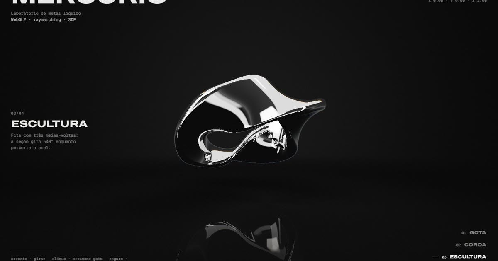

# Mercúrio — laboratório de metal líquido

**Ao vivo:** https://mercurio-carlos-eduardo.vercel.app



Experimento WebGL2 de Carlos Eduardo. Metal líquido renderizado por **raymarching** em tempo real, sem bibliotecas (3 arquivos, ~30 KB).

- **Técnica:** SDF (funções de distância) com smooth-min; estúdio de luz procedural; interreflexão de 1 salto; aberração cromática na borda; piso com reflexo e sombra de contato; antisserrilhado pela distância mínima do raio; resolução adaptativa por FPS.
- **Física (CPU → uniforms):** gotas com mola + gravidade + arrasto que se fundem de volta; ondas de impacto; gelatina (squash) com volume preservado; amassado que segue o cursor com atraso viscoso.
- **Interação:** arrastar gira · clicar arranca gota · segurar aquece · rolar/setas/1–4 troca de estado · `D` abre o painel de depuração.
- **Estados:** 01 Gota → 02 Coroa (Worthington) → 03 Escultura (fita com 3 meias-voltas) → 04 Sólido. Link direto: `?s=1..4`.

## Rodar
```
python -m http.server 5190
```
Abrir http://localhost:5190. Para publicar, basta subir a pasta (Vercel/Netlify/GitHub Pages): é estático.
